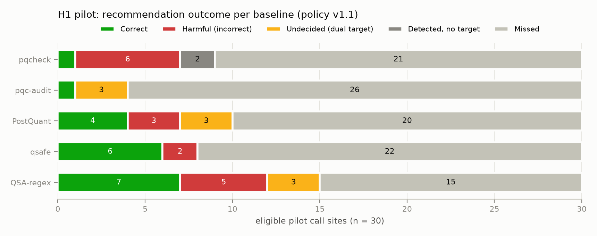

# Phase 1 — Research Specification, Pilot and Data Foundation

**Project:** Post-quantum crypto scanner for Python projects (title fixed).
**Mandatory base paper:** Lei Zhang. "Toward Quantum-Safe Software Engineering: A Vision for Post-Quantum Cryptography Migration." ICSE-Companion '26, pp. 402–403. DOI 10.1145/3774748.3795653. arXiv:2602.05759. The project instantiates Pillar P1 (PQC-aware detection with protocol roles and enriched inventories); P2/P3 are out of scope except an optional single-pattern validation experiment.
**Date:** 12 November 2026. **Phase outcome:** CONDITIONAL PASS (Section 12).

Everything in this report was performed in this phase; nothing is projected. Status words follow the tracker vocabulary (NOT_STARTED / IN_PROGRESS / IMPLEMENTED / TESTED / VALIDATED / BLOCKED).

## 1. Phase objectives and scope

Establish that the research problem is observable before building anything, freeze the implementation boundaries, and build a trustworthy experimental foundation. Deliverables: environment inventory; six specification documents; role taxonomy and NIST-verified migration policy with independent review; a ~30-site feasibility pilot on two real repositories with existing scanners; benchmark schema, annotation guide and repository-split process; this report and its PDF.

Out of scope for Phase 1: any scanner code, Semgrep rules, CBOM generation, or benchmark generation (all Phase 2).

## 2. Tasks performed, in execution order

1. Inventoried the project folder (four research documents from the earlier feasibility and hostile-audit work; no code; no git repository) and the host (Windows 11, Python 3.12.10, Node 24, Docker installed but daemon stopped, WSL Ubuntu available).
2. Created a project virtual environment with `uv`; installed and smoke-tested Semgrep 1.185.0 natively on Windows; installed cryptography 47.0.0, pycryptodome 4.4.0, cyclonedx-python-lib 11.12.0, pytest, scipy, statsmodels, pypdf, reportlab, xhtml2pdf, markdown.
3. Cloned the five open-source baseline scanners at the commits pinned in the hostile audit and installed each in its own venv (PostQuant built from TypeScript with `npm ci` + `tsc`).
4. Cloned the two pilot repositories (paramiko 5.1.0, python-jose 3.5.0) and recorded commit hashes.
5. Downloaded Mehl's ESEM 2026 Zenodo record (DOI 10.5281/zenodo.19634475) and established that it contains scanner *results* (14,510 per-repository JSON files, aggregate CSV, 19-repo ground truth), not scanner source.
6. Downloaded FIPS 203, FIPS 204, SP 800-227 and NIST IR 8547 PDFs from nvlpubs.nist.gov, extracted their text with pypdf, and verified every statement later used in the policy.
7. Ran pqcheck (default and `cryptoct-default` policy, terminal/SARIF/CBOM), pqc-audit (CBOM), PostQuant (JSON, CBOM), qsafe (JSON, CBOM) and the Quantum-Safe Auditor regex stage (via a small driver, no LLM) on both repositories; preserved all raw outputs.
8. Read the candidate RSA/EC code regions of both repositories in full and annotated 31 call sites (30 eligible, 1 negative) with 19 fields each.
9. Wrote the join script that matches tool outputs to sites by file and line window, maps tool text to target classes, applies the policy scoring and generates the summary tables; fixed a path-normalisation defect found on the first run (paramiko's package directory equals its repository name).
10. Wrote the six specification documents and the benchmark documents.
11. Commissioned two independent reviews in separate contexts: a re-derivation of 12 pilot labels from source, and an adversarial cryptography review of the policy against the NIST text. Incorporated every finding (taxonomy rules 7–9, type-valid-consumer wording, split of a merged site, policy v1.1 with three major corrections).
12. Re-ran the join after the corrections; generated the outcome figure from the joined data; wrote the pilot analysis, the Phase 1 gate report, the tracker, and this report; built the PDF.

## 3. Technical decisions and justifications

| Decision | Justification |
|---|---|
| Semgrep CE installed natively on Windows (pip wheel) rather than via Docker/WSL | Docker daemon was not running; the native wheel executed a rule correctly (1 result, 0 errors). Pinned at 1.185.0. |
| Each baseline in an isolated venv / node build at a pinned commit | Reproducibility and the security rule "isolated environments for baseline tools". Commits recorded in `docs/pilot/pilot_manifest.json`. |
| Quantum-Safe Auditor evaluated as regex stage only | Its second stage requires an LLM (Ollama/Claude); the comparison must be deterministic and reproducible; the limitation is stated wherever QSA appears. |
| Mehl's scanner compared from its published outputs only | No source in the Zenodo record; paramiko output present, python-jose absent; import-level findings without recommendations → repository-level comparison only. |
| Judgments computed by script from a published policy, not by hand | Removes annotator discretion from scoring; the same adapters are reused in Phase 2. |
| Pilot repositories drawn from crypto-dense libraries already in baseline corpora | Pilot aims to test observability, not generalisation; using the baselines' own tuning repositories biases in their favour and strengthens a positive finding. Both become *development* repositories; the test split excludes them. |
| Policy pre-registered before any analyzer code; τ = T2 fixed | Development rule 12 and the protocol's leakage controls. |
| Ordinal tiers, no numeric confidence | Earlier audit: no calibration basis exists. |
| PDF built from Markdown with xhtml2pdf | Keeps an editable Markdown twin; page numbers and a generated contents page; figure embedded from the data-generated PNG. |

## 4. Architecture, workflows and implementation details

No scanner architecture was implemented in Phase 1. The target pipeline (Phase 2) is fixed in `docs/specification/system_requirements.md`: Semgrep candidates (A) → semantic layer (B) → role inference with evidence tiers (C) → policy/abstention (D) → CycloneDX 1.6 / SARIF (E) → evaluation harness (F) with baseline adapters (G).

Phase 1 workflow actually executed:

```
repositories (pinned)  ──► regex over-approximation + read code ──► h1_pilot_sites.csv (annotations)
baselines (pinned)     ──► raw_tool_outputs/*.{sarif,json,cbom.json}  ─┐
                                                                       ├► join_tool_outputs.py ──► h1_pilot_joined.csv, h1_pilot_summary.md
policy v1.1 (scoring rules) ───────────────────────────────────────────┘             └► plot_pilot.py ──► figures/pilot_outcomes.png
```

Role taxonomy (frozen v1.0): SIGN, VERIFY, KEY_ESTABLISHMENT, PK_ENCRYPT, PK_DECRYPT, KEY_MATERIAL_ONLY, PROTOCOL_CONFIG, UNKNOWN (+ NONE for ineligible negatives); assessability DETERMINATE/INDETERMINATE; 11 provenance kinds; nine labelling rules including "key material inherits the role of its type-valid consumer" and "one call expression per site".

Policy (v1.1): SIGN/VERIFY → SIG (ML-DSA, FIPS 204); KEY_ESTABLISHMENT → KEM (ML-KEM redesign, hybrid transitional, SP 800-227 Sec. 4.6); PK_ENCRYPT/PK_DECRYPT → KEM_DEM (KEM + KDF + AEAD; not a drop-in); KEY_MATERIAL_ONLY → INVENTORY; PROTOCOL_CONFIG → PROTOCOL_REVIEW; approved-PQ hybrids → NO_ACTION_HYBRID (transitional); UNKNOWN → ABSTAIN. Scoring: CORRECT / INCORRECT (ROLE_INCOMPATIBLE, FALSE_ASSURANCE, OVER_RECOMMENDATION) / UNDECIDED / UNJUSTIFIED / DETECTED_ONLY / MISSED / FALSE_POSITIVE_SITE, plus a drop-in-wording flag reported beside harmful counts.

## 5. Files created or modified

| Path | Purpose |
|---|---|
| `docs/specification/system_requirements.md` | L1–L4, FR1–FR9, NFR1–NFR9, constraints, environment baseline |
| `docs/specification/role_taxonomy.md` | frozen v1.0 roles, provenance, rules, evidence scopes |
| `docs/specification/recommendation_policy.md` | v1.1 standards basis, classes, policy table, scoring, review record |
| `docs/specification/api_coverage.md` | 24 pyca + 12 PyCryptodome API rows, all NOT_STARTED; explicit unsupported list |
| `docs/specification/evaluation_protocol.md` | pre-registered hypotheses, datasets, experiments A–E, statistics, freeze |
| `docs/specification/data_dictionary.md` | site record, tool result record, tiers, metrics, file layout |
| `docs/benchmark/benchmark_schema.json` | JSON Schema for site records |
| `docs/benchmark/annotation_guide.md` | labelling procedure, worked examples, QC |
| `docs/benchmark/repository_split.md` | exclusions (verified), proposed split, ground-truth process |
| `docs/pilot/pilot_manifest.json` | repository and tool commits, invocations, environment |
| `docs/pilot/h1_pilot_sites.csv` | 31 annotated sites |
| `docs/pilot/h1_pilot_joined.csv`, `h1_pilot_summary.md` | generated judgments and tables |
| `docs/pilot/h1_pilot_analysis.md` | pilot analysis and kill-criterion decision |
| `docs/pilot/figures/pilot_outcomes.png` | outcome figure (generated) |
| `docs/pilot/raw_tool_outputs/` (34 files) | unmodified baseline outputs, Mehl artefact extracts |
| `experiments/pilot/join_tool_outputs.py` | adapters + scoring + summary generation |
| `experiments/pilot/plot_pilot.py` | figure from joined CSV |
| `experiments/pilot/qsa_regex_driver.py` | runs QSA's regex stage without an LLM |
| `scripts/build_pdf_report.py` | Markdown → PDF with contents page and page numbers |
| `docs/implementation/phase1_report.md` | stage reports A–J and gate table |
| `docs/implementation/implementation_tracker.md` | requirement status tracker |
| `docs/reports/Phase_1_Research_and_Feasibility_Report.md/.pdf` | this report |

Earlier research documents (`docs/research/01_*`, `02_*`) were read, not modified.

## 6. Commands and tools used

```
uv venv .venv --python 3.12
uv pip install --python .venv/Scripts/python.exe semgrep cryptography==47.0.0 pycryptodome cyclonedx-python-lib \
    reportlab markdown pytest pyyaml jsonschema scipy numpy matplotlib statsmodels pydantic tabulate pypdf xhtml2pdf
.venv/Scripts/semgrep --config r.yaml t.py --json --metrics=off           # smoke test: 1 result
git clone --depth 50 https://github.com/<owner>/<repo>  (5 baselines)      # commits in pilot_manifest.json
git clone https://github.com/paramiko/paramiko ; git clone https://github.com/mpdavis/python-jose
uv pip install -e ./pqcheck ; uv pip install -e ./pqc-scanner ; uv pip install -r quantum-mcp/requirements.txt
npm ci --ignore-scripts && npm run build                                   # PostQuant 0.7.0
pqcheck scan <repo> -p cryptoct-default -f sarif -o ...   (and -f cbom, terminal)
pqc-audit <repo> --json
node postquant/dist/index.js analyze <repo> -f json --show-all --verbose  (and -f cbom)
python pqc_scan_cli.py <repo> --format json --cbom ...
python experiments/pilot/qsa_regex_driver.py <qsa-root> <repo> <out.json>
curl -sL https://nvlpubs.nist.gov/nistpubs/FIPS/NIST.FIPS.203.pdf ... (4 PDFs) ; pypdf text extraction
curl -sL https://zenodo.org/api/records/19634475 ; raw.zip, report.md, verification_report.md, ground_truth_curated.csv
python experiments/pilot/join_tool_outputs.py docs/pilot/h1_pilot_sites.csv docs/pilot/raw_tool_outputs \
    docs/pilot/h1_pilot_joined.csv docs/pilot/h1_pilot_summary.md
python experiments/pilot/plot_pilot.py docs/pilot/h1_pilot_joined.csv docs/pilot/figures/pilot_outcomes.png
python scripts/build_pdf_report.py docs/reports/Phase_1_Research_and_Feasibility_Report.md \
    docs/reports/Phase_1_Research_and_Feasibility_Report.pdf "Phase 1 — Research and Feasibility Report"
```

## 7. Tests executed and results

| Test | Result |
|---|---|
| Semgrep rule smoke test (pyca RSA keygen pattern on a 2-line file) | 1 result, 0 errors |
| Library import/version check in the venv | cyclonedx 11.12.0, pycryptodome 4.4.0, reportlab 5.1.0, statsmodels 0.15.0 |
| xhtml2pdf smoke test (table + code block) | PDF produced, 0 errors |
| Baseline runs on two repositories | pqcheck: 42 and 20 SARIF results; pqc-audit: 15 and 7 CBOM components; PostQuant: 22 and 61 findings (exit 1 = grade gate, expected); qsafe: 304 and 178 findings; QSA regex: 500 and 144 findings |
| Join script totals | 5 tools × 31 sites = 155 judgment rows; per-tool rows sum to 31 |
| Independent re-derivation of 12 pilot labels | role 12/12, assessability 12/12, provenance 11/12, obvious-from-name 12/12 |
| Independent policy review (v1.0) | APPROVE WITH CHANGES; 3 MAJOR + 8 MINOR; all fixed in v1.1 and re-verified against the source text |
| PDF build | see Section 12 |

No unit tests exist yet because no production code exists; the pilot scripts are research tooling and were verified by reconciling their outputs by hand against the raw files (e.g. pqcheck `rsakey.py:143` → ML-KEM-768 is visible in `raw_tool_outputs/pqcheck_policy_paramiko.txt`).

## 8. Experimental metrics, tables and figure

Eligible pilot sites n = 30 (plus one negative). Role not determinable from method/algorithm name alone: **16/30 = 53% (Wilson 95% CI 36–70%)**; statically indeterminate: **4/30 = 13% (CI 5–30%)**. Roles: SIGN 12, VERIFY 5, KEY_ESTABLISHMENT 5, UNKNOWN 4, KEY_MATERIAL_ONLY 2, PK_ENCRYPT 1, PK_DECRYPT 1. Provenance: attribute 13, loaded-PEM 5, generated 4, loaded-DER 2, loaded-JWK 2, parsed-blob 2, loaded-SSH 1, certificate 1.

| Tool (pinned) | Correct | Harmful | Undecided | Detected, no target | Missed | Harmful + undecided |
|---|---|---|---|---|---|---|
| pqcheck 0.1.0 | 1 | 6 (role-incompatible) | 0 | 2 | 21 | 20% |
| pqc-audit 0.4.1 | 1 | 0 | 3 | 0 | 26 | 10% |
| PostQuant 0.7.0 | 4 | 3 (false assurance) | 3 | 0 | 20 | 20% |
| qsafe 1.1.0 | 6 | 2 (role-incompatible) | 0 | 0 | 22 | 7% |
| Quantum-Safe Auditor regex | 7 | 5 (role-incompatible) | 3 | 0 | 15 | 27% |

No tool's text on the pilot sites triggered the drop-in-wording flag. The negative site (`padding.PKCS1v15()` constant) was reported as an RSA finding with an ML-KEM target by pqcheck and QSA.



Representative raw evidence (file:line in the pilot repositories; tool text verbatim from `raw_tool_outputs/`):

- pqcheck, `paramiko/rsakey.py:143` (inside `self.key.sign(...)`): "RSA [banned/critical] — Shor — migrate to ML-KEM-768".
- pqcheck and qsafe, `paramiko/kex_ecdh_nist.py:59` (`ec.generate_private_key` whose only consumer is `exchange(ec.ECDH(), …)`): "ECDSA — migrate to ML-DSA-65".
- PostQuant, `paramiko/rsakey.py:141` (`self.key.sign(`) and `jose/backends/cryptography_backend.py:380` (`self.prepared_key.encrypt(`): "Already using PQC — verify algorithm is NIST-approved"; pattern `python-pqc-pqcrypto` has call patterns `/sign\s*\(/` and `/encrypt\s*\(/`.
- pqc-audit, `paramiko/rsakey.py:188`: migrationTarget "ML-KEM (key establishment) / ML-DSA (signatures)" (undecided).
- No tool reported any of the 11 key-loading / key-construction sites, except QSA's regex on two of them (dual target).

## 9. Errors encountered, debugging and resolutions

| Error | Resolution |
|---|---|
| `pypdf` missing from the project venv (present only in the system Python) | installed into the venv; extraction re-run |
| Join script reported every paramiko site as MISSED on the first run | path normaliser stripped the leading `paramiko/` from already-relative paths because the package directory equals the repository name; replaced with a loader-aware normaliser (`rel()`), re-run, totals reconciled |
| `pqc-audit --markdown` exits 1 with a traceback | CBOM JSON output used instead; markdown report not needed |
| PostQuant `analyze` exits 1 | exit code is its grade gate ("fail at grade C or worse"); JSON output complete |
| NIST landing pages fetched by the first web agent contained abstracts only | PDFs downloaded directly from nvlpubs.nist.gov and text-extracted; every policy citation verified against the extracted text |
| Docker daemon not running | CBOMkit baseline deferred (BLOCKED); documented |
| One bash heredoc failed on quoting while writing the CSV | CSV written with the file tool instead |
| Independent review found a merged try/except loader pair labelled with a composite provenance | site split into P15a/P15b; taxonomy rule 7 added |

## 10. Failed experiments and unresolved issues

- Mehl's ESEM 2026 scanner could not be executed (no source in the Zenodo record); its published paramiko output was examined instead; python-jose is listed in its ground truth but absent from its raw results.
- CBOMkit (sonar-cryptography) not run (Docker).
- Quantum-Safe Auditor's LLM enrichment stage not run; only the regex stage was evaluated.
- The Consensus MCP connector stayed on its 3-result tier earlier in the project; the REST API with the user's key worked. The key was pasted into chat and should be rotated.
- Human review of taxonomy, policy and annotations has not happened yet.

## 11. Limitations and deviations from the original plan

- The pilot's annotator and both independent reviewers were AI systems working in separate contexts. The master prompt asks for "at least one independent person"; this is recorded as an open condition, not satisfied.
- 31 sites instead of exactly 30 (one negative added; one site split on review).
- The pilot covers pyca only; PyCryptodome idioms are untested until the synthetic benchmark.
- The repository list for the benchmark is proposed, not frozen; freezing is the first Phase 2 task so that commit hashes are pinned before Module C exists.
- A git repository was not initialised (the project folder had none and the user has not asked for commits); code-version freezing in Phase 3 will use a tagged commit once the user initialises the repository, or a tree hash otherwise.

## 12. Validation-gate results

| # | Criterion | Result |
|---|---|---|
| 1 | Frozen research specification exists | PASS |
| 2 | Supported API coverage documented | PASS (plan; no rows implemented) |
| 3 | Role and recommendation taxonomy defined | PASS |
| 4 | NIST-based policy independently checked | CONDITIONAL PASS (AI review incorporated; human review pending) |
| 5 | 30-site pilot completed and analysed | PASS; CONDITIONAL on human annotation review |
| 6 | Benchmark schema and annotation instructions exist | PASS |
| 7 | Repository split and ground-truth process documented | CONDITIONAL PASS (process frozen; list to be pinned in Phase 2) |
| 8 | Feasibility decision recorded | PASS — proceed with N1 + N2 (+ N3) |
| PDF | this report exists as PDF and opens | checked after build: see tracker entry 1.6 |

**Phase outcome: CONDITIONAL PASS.** Phase 2 is authorised with three carried conditions: human review before the Phase 3 freeze; manifest freeze before Module C; CBOMkit route decided or reported as not run.

## 13. References and source links

- Zhang, L. Toward Quantum-Safe Software Engineering: A Vision for Post-Quantum Cryptography Migration. ICSE-Companion '26, pp. 402–403. DOI 10.1145/3774748.3795653; arXiv:2602.05759.
- NIST FIPS 203 (ML-KEM), FIPS 204 (ML-DSA), FIPS 205 (SLH-DSA), August 2024 — https://csrc.nist.gov/pubs/fips/203/final, /204/final, /205/final.
- NIST SP 800-227, Recommendations for Key-Encapsulation Mechanisms, September 2025 — https://csrc.nist.gov/pubs/sp/800/227/final.
- NIST IR 8547, Transition to Post-Quantum Cryptography Standards, final, October 2026 — https://csrc.nist.gov/pubs/ir/8547/final.
- Mehl et al., ESEM 2026 (DOI 10.4230/LIPIcs.ESEM.2026.53); artefact DOI 10.5281/zenodo.19634475.
- Baselines: github.com/Rafael-Ryu/pqcheck (3e99c742a3…), github.com/rauleteee/pqc-scanner (b5ccaac159…, PyPI pqc-audit 0.4.1), github.com/postquantdev/postquant (4dc61b7965…), github.com/Miles0sage/quantum-mcp (ff4f6dc384…, qsafe 1.1.0), github.com/AnimeshShaw/quantum-safe-auditor (4d695503e6…).
- Pilot repositories: github.com/paramiko/paramiko @ 0e9ccb91e0f9a68f2587233d523ad7fe46e730fe (5.1.0); github.com/mpdavis/python-jose @ 018b310ddb8b50dcfd09a0c152117835a21dd656 (3.5.0).
- Prior project documents: `docs/research/01_research_feasibility_report.md`, `02_hostile_novelty_audit.md`, `02_final_decision_summary.md`, `02_audit_evidence_log.md`.

## 14. Next-phase prerequisites and recommendations

1. Run `verify_candidates.py` on the proposed repositories, write `benchmark/real/manifest.json` with commit hashes, and only then start Module C.
2. Obtain a human review (lecturer or external) of `role_taxonomy.md`, `recommendation_policy.md` and the 31 pilot labels; record outcomes in the review tables.
3. Start Docker Desktop (or choose a JVM route) so that CBOMkit can be run as a baseline; otherwise report it as not run.
4. Initialise a git repository if commit-based freezing is wanted in Phase 3.
5. Rotate the Consensus API key that was pasted into chat.
6. Phase 2 order: Module A (Semgrep rules with fixtures) → Module B → Module C → Module D → Module E → Module F/G adapters packaged from the pilot scripts → CLI → Phase 2 gate.
